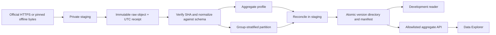

# Operating the snapshot pipeline

From the repository root, follow the [Windows setup](../README.md#run-locally-on-windows). The commands below use the editable installation and its console entry point. Node is needed only for the UI. No dependency versions changed. The acquisition client uses the already locked httpx package, promoted to a runtime dependency. Typed UTF-8 JSON Lines makes the 3,150-row snapshot portable with standard-library readers. Schema v1 defines integer and number fields. This choice avoids a columnar engine on Windows. Reassess Parquet and streaming aggregation before accepting longitudinal volumes.

```powershell
$cli = ".\backend\.venv\Scripts\retainiq-data.exe"
& $cli sources
& $cli run --dataset uci_iranian_churn
& $cli list
& $cli inspect --dataset uci_iranian_churn --version 461e2bba687bc6e8f52284c9
& $cli verify --dataset uci_iranian_churn --version 461e2bba687bc6e8f52284c9
& $cli profile --dataset uci_iranian_churn
python scripts/reconcile.py --version 461e2bba687bc6e8f52284c9
```

For separate steps, use `acquire`, `validate`, then `ingest`. Offline import uses `acquire --dataset uci_iranian_churn --file "C:\downloads\official.zip"` or an unchanged extracted official CSV, followed by `ingest`. To select a specific raw container when both exist, use `run --file <file>`. Plain run prefers the registered ZIP then the CSV. Source-container identity is deliberate, so importing the CSV creates a different version with equivalent normalized data. Read commands accept `--json`. Exit 0 means success, 1 signals data/I/O failure, and 2 indicates argument errors. Each invocation can take `--root DIRECTORY`; set RETAINIQ_DATA_ROOT to the same absolute directory for CLI and API. The editable checkout defaults to repository data/. Other installs fall back to .retainiq-data under the working directory.



The manifest registry lives inside each finished version under processed. The API enumerates only registered source identities from its allowlist. Version identity hashes the source ID, exact raw SHA, pipeline version and split seed. Bump the pipeline version for changes to parsing, eligibility, serialization, settings or splitting. Acquisition time is in a separate first-publication receipt. SHA-256 covers each artifact. Canonical JSON uses sorted keys, finite numbers, UTF-8 and LF; standard-library float serialization is used. Source field order governs grouping. Row ordinals begin at 1 and refer only to the pinned file. The manifest describes source columns; records.jsonl adds record_id. Role-specific files nest approved features separately from target and record_id. A full-corpus audit file remains private.

The downloader uses a fixed HTTPS endpoint, certificate verification, 5-second connection and 15-second read timeouts, at most three transport attempts and a 2 MB byte ceiling. Redirects and transport compression are rejected. Exact hashes gate both online and offline imports. The ZIP reader allows one regular member with the expected name, limits compressed expansion to 100:1, bounds decoded bytes and never extracts to user-controlled paths. A source change needs a reviewed contract and a new hash.

Each writer creates an independent staging directory on the destination filesystem and renames a completed directory into place. Concurrent writers verify the winner. Readers see only committed versions. Normal failures remove temporary directories. After a machine crash, stop all writers before removing orphan temporary directories from staging. Raw objects without a processed version are safe to re-ingest. A conflicting file or failed checksum requires investigation: preserve the old store and rebuild into an empty root from verified source bytes. Never patch a published artifact in place. Use a trusted local filesystem; network filesystem rename semantics and power-loss durability have not been tested.

## Future adapter boundary

An adapter must register a stable ID, official authority, license, immutable inputs, schema and evidence-backed target contract. It must implement validated acquisition, normalization, source-specific limits and capability flags before registration. KKBox requires verified terms and a storage budget. IBM requires file-level rights review. Neither adapter exists. See [source strategy](DATASET_STRATEGY.md).

For longitudinal sources, identify customers and subscriptions by stable scoped keys. Join usage, billing and support events only when both occurred_at and available_at are at or before the observation cutoff. Churn outcomes must fall within a declared (cutoff,end] window; follow-up short of the end is censored unless a relevant event was observed. Intervention assignments need assignment ID, assignment timing, treatment/control and cost/currency. Link subsequent observed outcomes to assignment and define follow-up. Evidence of causal effect requires an experimental or defensibly identified design. The Event and OutcomeWindow models validate timezone-aware chronology, cost units, assignment linkage and observation coverage. They are schema primitives for future adapters. The UCI snapshot supplies no such event stream.
