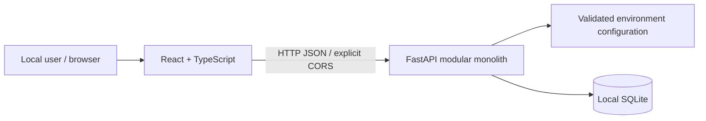
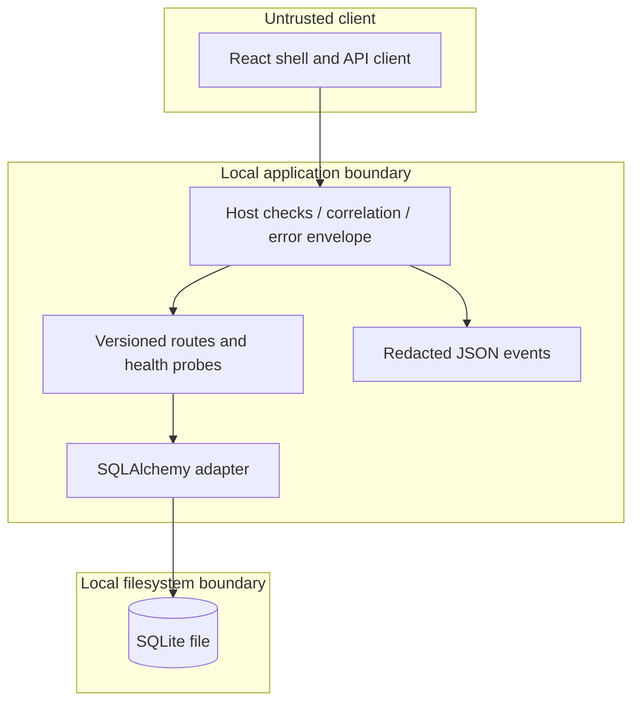
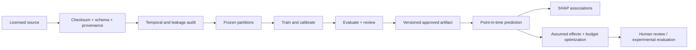

# Architecture and lifecycle
## Implemented system
Local-first modular monolith. API contracts, configuration and infrastructure are separate Python
modules; React calls metadata endpoints. SQLAlchemy probes SQLite; no business tables exist yet.
PostgreSQL dialect is planned and requires psycopg and separate compatibility testing.

## Components and trust boundaries

Browser input and request IDs are untrusted; only bounded safe IDs are reflected. No bodies,
queries, credential-bearing URLs or exception text are logged. OS file permissions protect local DB.
## Planned data flow (not implemented)

Training uses bounded memory, training-only transformations and versioned splits. Model versions move
through draft, evaluated, approved, active, retired; failed evaluations are retained and cannot activate.
Prediction pins dataset, model, schema, horizon and timestamp; invalid input fails closed. Explanation
pins model/background versions. Recommendations specify assumed effects, constraints, costs and
uncertainty; human approval precedes any intervention. Outcomes require a separate causal evaluation.
## Workspace isolation (planned)
Server-issued random guest identity, opaque HttpOnly session, short TTL, quotas, synthetic fixtures.
All business rows carry workspace_id; service-layer authorization derives scope from session, never
from a client ID alone. Cross-workspace denial tests, export/artifact checks and expiry deletion are
release gates. SQLite is single-instance; PostgreSQL RLS is an additional future defense, not present.
## Deployment and failures
Native Python + Vite works locally; Docker is optional. Future static hosting + API needs HTTPS,
explicit CORS/hosts and no durable SQLite assumption on ephemeral disks. See deployment strategy.
Liveness checks process response only. Readiness probes DB on every request and returns 503 if
unavailable, including initialization failure, then recovers after connectivity returns. Shutdown
disposes engine; Uvicorn handles graceful signals. Production disables interactive API docs.
Frontend aborts API requests after five seconds and supports explicit retry; no infinite retry loop.
SQLite busy timeout is two seconds. Production proxy must enforce ~15 second total request deadline,
header/body limits and bounded concurrency before public use. Uvicorn keep-alive is not a total
request timeout. Future compute jobs require explicit budgets/cancellation outside request workers.
## Backup and recovery
No customer records are stored in Phase 0. Future local backup uses SQLite online backup API to a
separate protected location, verifies checksum and performs restore rehearsal; never copy a live WAL
database blindly. PostgreSQL backup/restore policy must be tested before adoption. Recreate Phase 0
DB safely only when it contains no user data; migrations must precede future schema changes.
## Resources and security
16 GB RAM host, roughly 3.6 GB free during audit. No ML libraries installed. Process training in
bounded batches later; downsample only with documented representativeness limits. Threat register:
../security/THREAT_MODEL.md. Neither public multi-tenancy nor production readiness is claimed.
